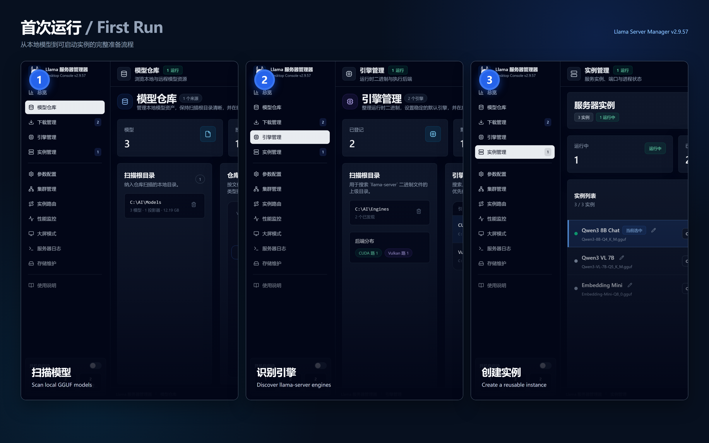
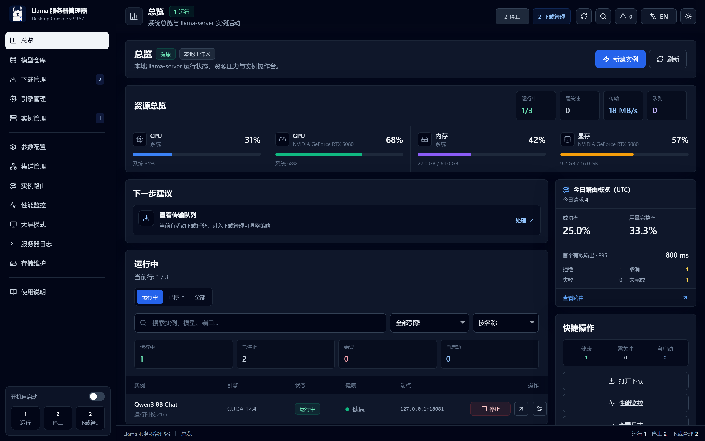
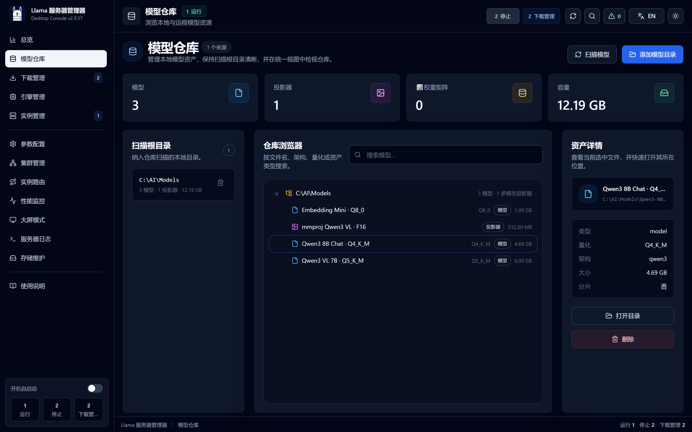
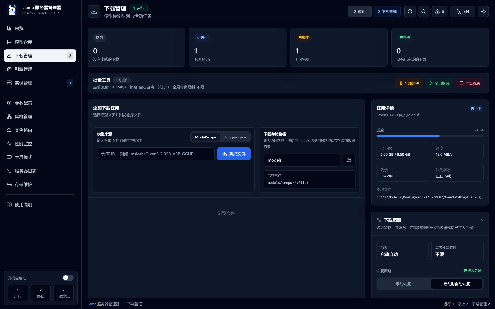
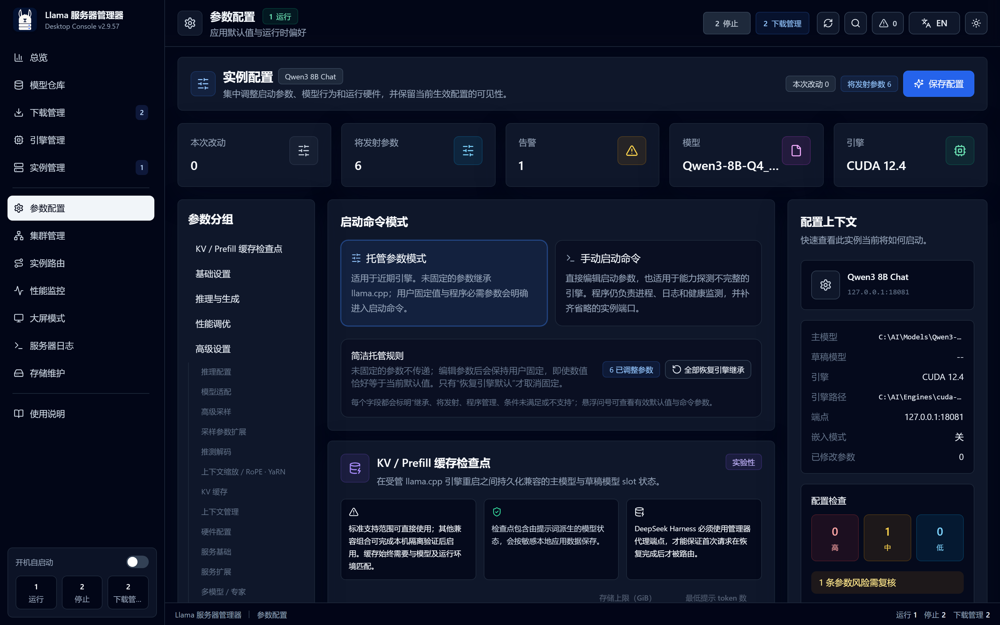
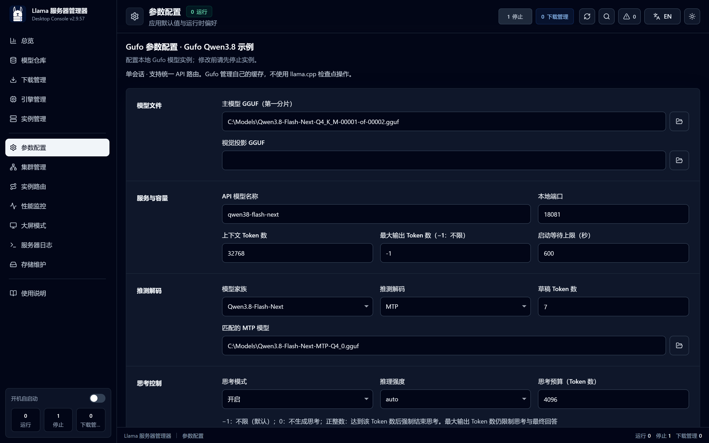
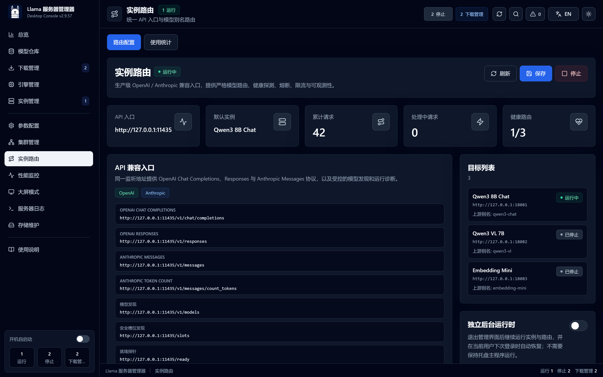
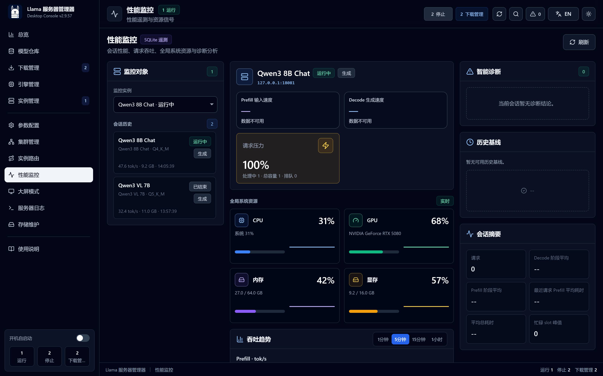

# Llama Server Manager / Llama 服务器管理器

> Windows、macOS、Linux 已验证 | Verified on Windows, macOS, and Linux

Llama Server Manager 是面向 llama.cpp 与 Windows Gufo 的桌面管理器，覆盖模型下载与扫描、引擎管理、实例配置与启停、集群 Worker、统一 API 路由、用量统计、性能遥测、后台任务和存储维护。

Llama Server Manager is a desktop manager for llama.cpp and Windows Gufo, covering models, engines, instance lifecycle, cluster workers, unified API routing, usage accounting, telemetry, background tasks, and storage maintenance.

[官方网站 / Website](https://docs.cnzone.net/) | [备用官网（东京） / Mirror (Tokyo)](https://mirror.cnzone.net/) | [使用文档 / Documentation](https://docs.cnzone.net/docs) | [下载中心 / Download](https://download.cnzone.net/) | [版本说明 / Release Notes](https://docs.cnzone.net/release-notes) | [GitHub Releases](https://github.com/jerrydong1988/llama-server-manager/releases/latest)

主站访问缓慢或不可用时，可手动打开[东京备用官网](https://mirror.cnzone.net/)。备用站定期同步经验证的官网内容，不会自动接管主站访问。安装包下载与应用内更新仍使用现有 Cloudflare R2 分发。

If the primary site is slow or unavailable, open the [Tokyo mirror](https://mirror.cnzone.net/) manually. The mirror periodically syncs validated website content; traffic does not switch automatically. Installer downloads and in-app updates still use the existing Cloudflare R2 distribution.

## 安装与更新 / Install and Update

优先从[下载中心](https://download.cnzone.net/)获取适合当前平台的正式安装包；[GitHub Releases](https://github.com/jerrydong1988/llama-server-manager/releases/latest)保留为备用下载源。

Use the [Download Center](https://download.cnzone.net/) for the recommended platform package. [GitHub Releases](https://github.com/jerrydong1988/llama-server-manager/releases/latest) remains available as an alternative source.

| 平台 / Platform | 安装包 / Package | 更新方式 / Update path |
|---|---|---|
| Windows x64 | NSIS、MSI | `v2.9.36+` 支持应用内更新 / In-app updates from `v2.9.36+` |
| macOS Apple Silicon | DMG | `v2.9.36+` 支持应用内更新 / In-app updates from `v2.9.36+` |
| Linux x64 / ARM64 | DEB | 推荐；从下载中心手动更新 / Recommended; update manually from the Download Center |

`v2.9.35` 及更早版本尚未内置 Tauri Updater，需要先手动安装 `v2.9.36` 或更新版本。应用内更新由 Cloudflare R2 分发，并在安装前执行项目专用的 Tauri 签名校验。自 `v2.9.43` 起，Linux 暂停发布 AppImage，以避免其内置 GLib/Wayland 与新系统图形栈混用导致空白窗口；请使用 DEB，Linux 暂不提供应用内更新。

`v2.9.35` and earlier do not include Tauri Updater and must first be upgraded manually to `v2.9.36` or later. In-app updates are distributed through Cloudflare R2 and verified with the project-specific Tauri signature before installation. Starting with `v2.9.43`, Linux AppImage distribution is suspended because mixing bundled GLib/Wayland libraries with newer system graphics stacks can produce a blank window. Use the DEB package; in-app updates are temporarily unavailable on Linux.

## 快速开始 / Quick Start

1. 在“模型仓库”添加本地 GGUF 目录，或从“下载管理”获取模型。
2. 在“引擎管理”扫描包含 `llama-server` 的目录；Windows 也可登记兼容的 Gufo 引擎，创建实例时明确选择引擎类型。
3. 在“实例管理”创建实例，选择模型、引擎和可用端口。
4. 在“参数配置”检查所选引擎的模型、上下文和服务参数，然后保存；llama.cpp 与 Gufo 使用各自的配置页。
5. 启动实例，通过“性能监控”和“服务器日志”确认运行状态。

1. Add a local GGUF directory or download a model.
2. Scan `llama-server` builds, or register a compatible Gufo engine on Windows; select the engine type when creating an instance.
3. Create an instance with a model, engine, and free port.
4. Review the selected engine's model, context, and service options in its llama.cpp or Gufo configuration page, then save.
5. Start the instance and verify it in Performance and Logs.



## 界面预览 / Interface Preview

截图使用隔离的演示数据展示当前界面。实际模型支持、参数能力和性能以所选引擎及运行结果为准。

Screenshots use isolated demonstration data. Model support, parameter availability, and performance depend on the selected engine and actual workload.

### 系统总览 / Dashboard

汇总系统资源、实例状态、模型、引擎、下载和需要处理的问题。

System resources, instances, models, engines, downloads, and actionable issues in one view.



### 模型与下载 / Models and Downloads

递归扫描 GGUF 目录，识别模型、分片和投影器；支持 ModelScope 与 HuggingFace 队列下载、断点续传、并发和限速策略。

Scan GGUF models, shards, and projectors; manage ModelScope and HuggingFace queues with resume, concurrency, and bandwidth policies.





### 实例配置 / Instance Configuration

为每个 llama.cpp 实例独立选择模型、引擎和端口，通过参数搜索、场景预设和分级校验调整结构化选项，并依据所选 `llama-server --help` 进行运行时能力协商。当前上游稳定版 v0.9.0 基线跟踪 261 个参数条目。

Choose model, engine, and port per llama.cpp instance, tune structured options with search, presets, and validation, and negotiate runtime capabilities against the selected `llama-server --help`. The current stable upstream v0.9.0 baseline tracks 261 parameter entries.



### Gufo 实例 / Gufo Instances

Windows 支持 Gufo 的 Qwen3.8-Flash-Next + MTP、Qwen3.8-27B + DFlash2 配置与统一 API 路由。主模型、视觉投影、MTP 和 DFlash2 文件可从模型仓库选择；思考预算使用独立字段，−1 不限、0 不生成思考、正整数限制思考 Token 数。每个实例使用 Manager 数据目录下的独立 Gufo 缓存；Gufo 不使用 llama.cpp 检查点。具体引擎构建和模型文件仍需兼容。

Windows supports Gufo configurations for Qwen3.8-Flash-Next + MTP and Qwen3.8-27B + DFlash2, including unified API routing. Pick model, projector, MTP, and DFlash2 files from the repository. Gufo has its own reasoning budget: −1 for unlimited, 0 for no reasoning, or a positive token limit. Each instance has its own Gufo cache under Manager's data directory; llama.cpp checkpoints do not apply. The engine build and model files must be compatible.



### 实例路由 / Instance Routing

把多个运行实例聚合为生产级 OpenAI / Anthropic 兼容入口。支持 Chat Completions、Responses、Messages、Token Count、Embeddings、Rerank、严格模型边界、四种调度策略、主动健康探测、熔断、并发与限流、细粒度 API Key、CORS、安全 `/props`/`/slots` 发现和 Prometheus 指标。

Expose running instances through one production OpenAI / Anthropic-compatible gateway with Chat Completions, Responses, Messages, embeddings, rerank, strict model boundaries, four schedulers, active probes, circuit breaking, concurrency and rate limits, scoped API keys, safe capability discovery, and Prometheus metrics.



### 性能监控 / Performance Monitoring

查看 CPU、内存、GPU、显存、历史会话和诊断建议；生成模型分别显示 Prefill 输入速度、Decode 输出 tokens/s 与 slots，Embedding 输入 tokens/s、向量项/s，Reranker 输入 tokens/s、文档项/s。任务日志覆盖直连请求和应用内流量，代理请求统计补充 HTTP 请求数、耗时和失败率；未取得的来源会明确显示为不可用。

Inspect resources, history, and diagnostics with workload-aware metrics: separate Prefill input and Decode output rates for generation, input tokens/s and vector items/s for Embedding, and input tokens/s and document items/s for Reranker. Task logs include direct traffic, while proxy telemetry adds HTTP request counts, latency, and failures; missing sources remain explicitly unavailable.



## 功能地图 / Feature Map

| 页面 | 主要能力 | Page | Main capability |
|---|---|---|---|
| 系统总览 | 系统健康、实例控制、关注中心、近期活动 | Dashboard | Health, instance controls, attention items, recent activity |
| 模型仓库 | GGUF 递归扫描、元信息、分片与投影器识别 | Models | Recursive inventory, metadata, shards, and projectors |
| 下载管理 | 双源浏览、队列、暂停恢复、并发、限速 | Downloads | Dual-source browsing, queues, resume, concurrency, throttling |
| 引擎管理 | 多版本扫描、后端识别、默认引擎 | Engines | Multi-version scanning, backend detection, defaults |
| 实例管理 | 多实例、端口检查、启停、连接测试、命令预览 | Instances | Multi-instance lifecycle, port checks, health, command preview |
| 参数配置 | 搜索、预设、校验、鉴权、缓存和推测解码 | Configuration | Search, presets, validation, auth, cache, speculative decoding |
| 集群管理 | Worker 发现、本地与 SSH 启动、RPC 配置 | Cluster | Worker discovery, local or SSH launch, RPC configuration |
| 实例路由 | 双协议 API、严格路由、调度、熔断、限流、可观测性 | Routing | Dual-protocol API, strict routing, scheduling, resilience, observability |
| 路由使用统计 | 请求诊断、Token 用量、Key 预算与强制额度、CSV 导出 | Router Usage | Request diagnostics, tokens, key budgets, hard quotas, CSV export |
| 性能监控 | 生成与向量吞吐、双来源遥测、历史基线和诊断 | Performance | Generation and vector throughput, dual-source telemetry, baselines, diagnostics |
| 监控大屏 | 服务健康、吞吐、压力、下载和告警 | Monitoring Wall | Health, throughput, pressure, downloads, alerts |
| 服务器日志 | 实时 stdout/stderr、筛选、跟随和持久化 | Logs | Live output, filtering, tail follow, persistence |
| 存储维护 | 暂存清理、遥测整理、WebView 缓存、目录授权与外部文件盘点 | Storage | Staging cleanup, telemetry maintenance, WebView cache, directory access and external inventory |
| 任务中心 → 后台任务 | 管理操作进度、结果、取消与历史清理 | Background Tasks | Management task progress, results, cancellation and history cleanup |
| 使用说明 | 离线图文手册、启用检查、六步 llama.cpp 引导与进阶导览 | Guide | Offline manual, checklist, six-step llama.cpp setup and advanced tour |

## 关键特性 / Key Features

- Tauri 2 + React 18 + TypeScript 桌面应用。
- 完整中英双语界面、深色 / 明亮主题、窗口状态记忆。
- AMD ADLX、NVIDIA NVML 和系统指标自适应降级。
- 实例 API Key 与 API Key 文件支持；统一路由支持摘要持久化的多 Key、推理/发现权限、独立限流和精确 Origin CORS。
- 同一统一路由原生支持 OpenAI Chat Completions / Responses 与 Anthropic Messages，并提供严格模型边界、健康探测、熔断、四种调度策略、安全 `/slots` 发现和 Prometheus 指标。
- 可选的实验性 KV / Prefill Cache Checkpoint 保存已获资格的 slot 集合；标准支持范围之外的兼容 Windows/ROCm 组合可运行隔离本机验证。`draft-*` 需要 target/draft context 持久化能力、正数 `ctx_checkpoints` 及匹配的资格证据；多 slot 需要验证整组保存与恢复。资格绑定模型、运行库、配置和环境，修改 `LLAMA_KV_ROWS_DISABLE` 或使用旧凭据时需重新验证。恢复失败后通过新进程隔离，文件验证与实际请求复用指标分别展示。
- 任务中心统一查看 CLI/MCP 管理操作的结果与历史；存储维护区分可清理暂存、需重启的缓存、目录授权和仅供盘点的外部输出。
- CLI/MCP 通过本机管理接口共享状态；先打开应用或显式执行 `lsm service start`，连接本身不会自动唤醒已退出的宿主。
- 独立后台运行时可在管理界面退出后继续托管实例与路由，并在当前用户登录后恢复。
- 原子配置保存、`instances.json.bak` 回退、下载队列与日志持久化。
- 端口冲突、路径、配置规则和启动健康检查。
- 系统托盘、实例自动启动，以及由 Cloudflare R2 分发、Tauri 签名校验的应用内更新。

- Tauri 2, React 18, and TypeScript desktop application.
- Full Chinese and English UI, light and dark themes, persisted window state.
- AMD ADLX, NVIDIA NVML, and system-metric fallback.
- Inline or file-based instance keys plus hashed, scoped multi-key routing authentication, per-key limits, and exact-origin CORS.
- Native OpenAI Chat Completions / Responses and Anthropic Messages on one listener, with strict model boundaries, active probes, circuit breaking, four schedulers, safe `/slots` discovery, and Prometheus metrics.
- Optional experimental KV / Prefill Cache Checkpoint saves the qualified slot set. Compatible Windows/ROCm configurations outside reviewed profiles may run isolated local validation. Draft state requires target/draft context persistence, positive `ctx_checkpoints`, and matching qualification evidence; multiple slots must pass complete-set save and restore. Model, runtime, configuration and environment identity are bound together. Changes to `LLAMA_KV_ROWS_DISABLE` or legacy receipts require revalidation. Failed restores require a fresh process; file verification and observed request reuse are separate.
- The task center shares CLI/MCP management results and history. Storage maintenance separates cleanup, restart-only caches, directory permissions, and external-file inventory.
- CLI/MCP shares local management state. Open the app or explicitly run `lsm service start`; connecting does not wake a host after an explicit exit.
- An independent background runtime that keeps instances and routing alive after the management UI exits and restores them at user login.
- Atomic configuration saves, backup fallback, persistent downloads and logs.
- Port, path, configuration, startup, and health validation.
- System tray, instance auto-start, and Tauri-signed in-app updates distributed through Cloudflare R2.

## 系统要求 / Requirements

运行已构建安装包不需要安装 Rust 或 Node.js。你需要：

- Windows 10/11、macOS 13+（Apple Silicon），或满足当前 DEB 安装包依赖的 Linux x64 / ARM64 系统。
- 与硬件和驱动匹配的 `llama-server`，或 Windows 上兼容的 Gufo 安装目录。
- 至少一个 GGUF 模型，或可访问 ModelScope / HuggingFace 的网络。
- 足够容纳模型、上下文和 KV 缓存的内存或显存。

Built packages do not require Rust or Node.js. You need a supported OS, a compatible `llama-server` or Windows Gufo installation, a GGUF model or repository access, and enough memory for the model and KV cache.

## 从源码构建 / Build from Source

源码构建需要 Node.js 20.19.x 及更新的 20.x，或 Node.js 22.12 及以上版本、Rust stable 和对应平台的 Tauri 系统依赖。

Source builds require Node.js 20.x from 20.19, or Node.js 22.12 or newer, stable Rust, and platform-specific Tauri dependencies.

```bash
git clone https://github.com/jerrydong1988/llama-server-manager.git
cd llama-server-manager
npm ci --ignore-scripts
npm rebuild esbuild
npm run tauri dev
```

生产构建 / Production build:

```bash
npm run tauri build
```

Ubuntu / Debian 构建依赖：

```bash
sudo apt install libwebkit2gtk-4.1-dev libappindicator3-dev librsvg2-dev patchelf
```

没有配置 Apple Developer 凭据时，macOS 构建使用 ad-hoc 签名并正常发布。首次运行可能被 Gatekeeper 提示；如信任本项目，可移除本地下载隔离属性：

```bash
xattr -cr /Applications/LlamaServerManager.app
```

正式 `v*` 标签不会因缺少商业证书而停止发布。配置 SignPath 后 Windows 安装包会自动提交签名；配置 Apple Developer 凭据后 macOS 安装包会自动签名并公证。未配置时，CI 会明确标记相应产物为未签名或 ad-hoc 签名。无论操作系统证书是否配置，应用内更新都必须通过独立的 Tauri Updater 签名校验，并在发布产物固定后才上传到 R2；配置方法见[发布签名配置](docs/RELEASE_SIGNING.md)。

## 使用说明与问题反馈 / Guide and Support

仓库 `GUIDE.md` 是应用内离线手册的内容源，随安装包发布；仅更新仓库或官网不会改写已安装版本的手册。在线文档、版本说明和下列专题入口用于查阅补充信息。

`GUIDE.md` is the source of the in-app offline manual and ships with each installer. Repository and website updates do not replace an already installed manual. Use the online guide, release notes, and topic links below for additional information.

- [官方网站 / Website](https://docs.cnzone.net/)
- [在线使用文档 / Online Documentation](https://docs.cnzone.net/docs)
- [下载中心 / Download Center](https://download.cnzone.net/)
- [在线版本说明 / Online Release Notes](https://docs.cnzone.net/release-notes)
- [仓库版离线图文说明 / Repository Offline Guide](GUIDE.md)
- [隐私政策 / Privacy Policy](PRIVACY.md)
- [代码签名政策 / Code Signing Policy](CODE_SIGNING_POLICY.md)
- [依赖安全审计 / Dependency Audit](docs/DEPENDENCY_AUDIT.md)
- [llama.cpp 参数兼容机制 / llama.cpp Compatibility Policy](docs/LLAMA_CPP_COMPATIBILITY.md)
- [KV / Prefill Cache Checkpoint](docs/KV_CACHE_CHECKPOINT.md)
- [检查点本机验证 / Local Checkpoint Qualification](docs/CHECKPOINT_ADMISSION_POLICY.md)
- [Gufo 使用说明 / Gufo User Guide](GUIDE.md#gufo-实例-gufo-instances)
- [生产级模型路由器 / Production Model Router](docs/ROUTER_API_COMPATIBILITY.md)
- [Anthropic API 与 Claude Code 配置 / Anthropic API and Claude Code](docs/ANTHROPIC_API_COMPATIBILITY.md)
- [CLI/MCP 与后台任务 / CLI, MCP and Background Tasks](docs/agent-management-exploration.md)
- [问题反馈 / Report an Issue](https://github.com/jerrydong1988/llama-server-manager/issues)
- 应用内左侧“使用说明”可离线查看同一内容，并启动交互式引导。
- 提交问题前请附版本、平台、后端类型和已脱敏的服务器日志；不要上传 API Key、私有路径或 SSH 凭据。

- The in-app Guide provides the same content offline and launches the interactive walkthrough.
- Include version, platform, backend, and redacted logs in issue reports. Never expose keys, private paths, or SSH credentials.

## License

MIT
